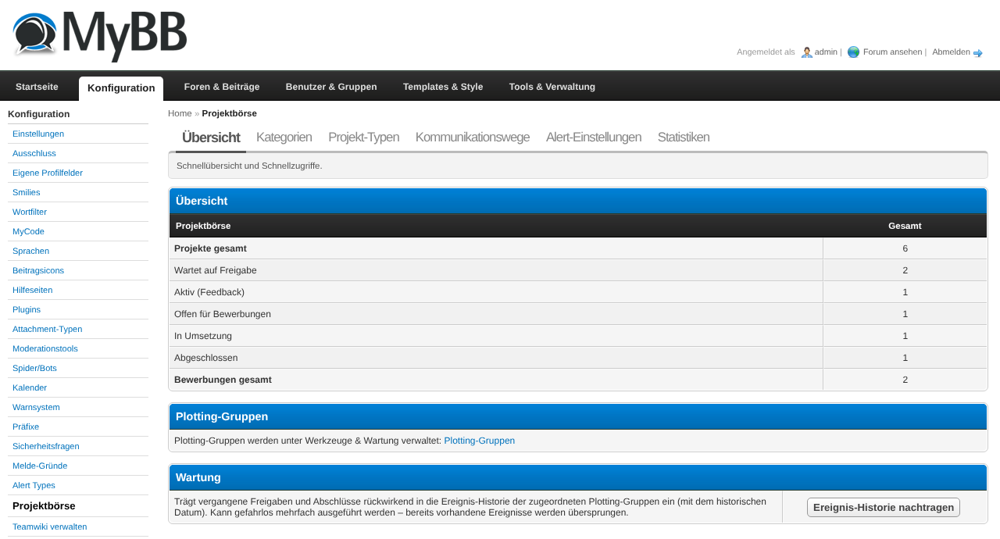
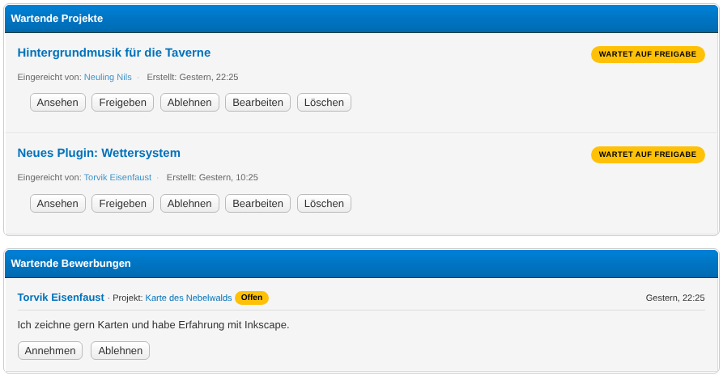
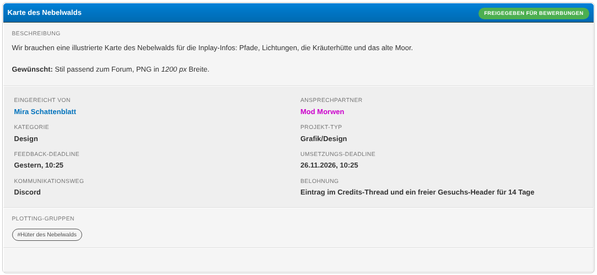
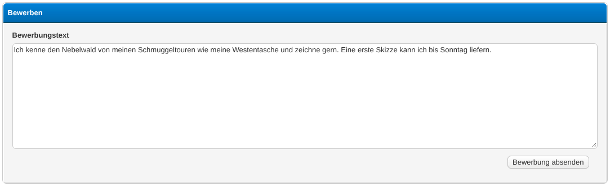

# Projektbörse

A MyBB 1.8 plugin that provides a full project-board workflow for RPG forums:
submitters propose projects, the team reviews and refines them, a public
feedback phase collects input, the project opens for applications, one or more
implementers are chosen, and the project is tracked through to completion.

## Requirements

- **MyBB:** 1.8.x
- **PHP:** 7.4 or 8.x
- **Database:** MySQL 5.7+ / MariaDB 10.2+ (utf8mb4)
- **Dependencies:** None.
  *Optional:* [MyAlerts](https://community.mybb.com/mods.php?action=view&pid=521)
  – if installed, alerts are pushed to MyAlerts; without it they are still
  written to the plugin's own log table.
  *Optional:* [plottinggroups](https://github.com/pand0rica/plottinggroups)
  – enables assigning projects to plotting groups and notifying their members.
  When a project is **approved** or **completed**, the event is also added to the
  "latest events" history of every plotting group it belongs to. Without it the
  group section simply does not appear; existing assignments are preserved and
  shown as plain labels. **Activate plottinggroups first**, so its groups exist
  before you assign them here.

## Installation

1. Upload all files into your MyBB root directory, keeping the folder
   structure (`inc/plugins/...`, `admin/modules/config/...`, etc.).
2. Open the ACP → **Configuration → Plugins** and click *Install & Activate*
   next to **Projektbörse**.
3. Open **Configuration → Settings → Projektbörse** and review the user-group
   IDs for submitters, applicants and the team.
4. Open **Configuration → Projektbörse** (the new ACP entry) to manage
   categories, project types, communication channels, alert preferences
   and statistics.
5. *Optional:* to use plotting groups, activate the **plottinggroups** plugin and
   create your groups under **Tools & Maintenance → Plotting Groups**. They then
   appear as checkboxes in the project form.

## Configuration

The plugin adds one setting group (**Projektbörse**) with these options:

| Setting | Type | Purpose |
|---|---|---|
| `projektboerse_enabled` | yes/no | Master switch for the frontend |
| `projektboerse_allowed_groups` | group multi-select | **Master allowlist** – only members of these groups may interact with the plugin at all (submit, apply, team) and receive alerts. Leave empty for no restriction. Intended to exclude character accounts in RPG forums. |
| `projektboerse_submit_groups` | group multi-select | Who may submit projects (additionally filtered by `allowed_groups`) |
| `projektboerse_apply_groups` | group multi-select | Who may apply to projects (additionally filtered by `allowed_groups`) |
| `projektboerse_team_groups` | group multi-select | Who counts as team (reviews/approves) – additionally filtered by `allowed_groups` |
| `projektboerse_alert_*` | yes/no (×14) | Per-event MyAlerts toggles |
| `projektboerse_alert_published` | yes/no | **Broadcast to all eligible users** when a project is approved and enters the board (feedback phase). Recipients are resolved via `allowed_groups`; character accounts outside the allowlist receive nothing. The creator is skipped (they get the personal "approved" alert). |
| `projektboerse_alert_open` | yes/no | **Broadcast to all eligible users** when a project moves from the feedback phase to the application phase (open for applications). Same allowlist filtering; the creator is skipped. |
| `projektboerse_alert_group_assigned` | yes/no | Notify members of a plotting group when a project is assigned to it. Requires the plottinggroups plugin. Recipients are still filtered by `allowed_groups` – if a group consists solely of character accounts, no alert is sent. Add the relevant main-account group to `allowed_groups` to change that. |
| `projektboerse_alert_new_project_recipients` | csv user IDs | Extra recipients for new-project alerts |
| `projektboerse_feedback_recipients` | csv user IDs | Extra recipients during the feedback phase |
| `projektboerse_default_feedback_days` | numeric | Default feedback deadline (days) |
| `projektboerse_default_implementation_days` | numeric | Default implementation deadline (days) |
| `projektboerse_per_page` | numeric | Pagination size on the listing |
| `projektboerse_allow_html` | yes/no | Allow safe HTML in project content (descriptions, reward, applications, comments). The Links field always supports BBCode independently of this setting. Sanitized server-side against an allow-list – script tags, event handlers and `javascript:`/`data:`/`vbscript:` URLs are stripped. Default off (plain text + `nl2br`). |

## Usage

### First steps after activation
1. Set `projektboerse_allowed_groups` to the user-account groups that should
   be allowed to use the plugin at all (leave empty to allow everyone).
   Character-account groups in RPG forums should **not** be listed here so
   they neither receive alerts nor can submit/apply.
2. Decide which user groups belong to which role and update the three
   `*_groups` settings (submit, apply, team).
3. Open **ACP → Configuration → Projektbörse → Categories** and add at least
   one category (defaults *Entwicklung*, *Design*, *Content*, *Administration*
   are pre-seeded).
4. Repeat for **Project types** and **Communication channels** if the seeded
   defaults don't fit your forum.

### Core workflow

The board lives at `yourforum.tld/projektboerse.php`. The main board view is
grouped into one section per category (in the category display order), so
projects are easy to browse by topic. The lifecycle of a project follows these
states:

```
pending → active → open → implementation → completed
                   ↑               │
                   └──── reopen ───┘
```

#### Submitters
- Open `projektboerse.php` and click **New project**.
- Required: title, description, category.
- After submission the project sits in `pending` until the team approves it.

#### Team members (ModCP → Projektbörse)
- **Pending projects** are listed first. Open the approval form, fill in
  project type, communication channel, deadlines, optional reward, contact
  person and links (BBCode supported), then *Approve*.
- **Pending applications** are listed below. Accepting an application moves the
  project to `implementation` (on the first acceptance) and assigns the applicant
  as an implementer. You can accept **multiple applicants** for the same project –
  remaining applications stay open and can be accepted or rejected individually.
  The applications stay reachable from the project row while it is in
  `implementation`.
- **All projects** at the bottom of the page lets you edit, complete,
  archive, reopen or delete any project.

#### Applicants
- Open an `open` project, scroll to the application form, write a motivation
  and submit. You can apply only once per project.

### Deadlines
- A MyBB task (`projektboerse_deadlines`) runs every 30 minutes:
  - Projects in `active` whose `feedback_deadline` has expired are moved to
    `open`.
  - Projects in `implementation` whose `implementation_deadline` has expired
    receive an alert (at most once per 24h per project).

### Plotting groups (optional)
- When the **plottinggroups** plugin is active, the project form shows a
  checkbox list of the approved plotting groups. Assign a project to one or more
  groups so their members are notified once it becomes visible.
- Whenever such a project is **approved** (moves from `pending` to `active`) or
  **completed**, the event is additionally written to the *latest events* history
  of every assigned group. It shows up as *"Project approved"* / *"Project
  completed"* on the group's page, linking back to the project.
- Without the plottinggroups plugin nothing changes here – the section is hidden
  and no events are logged.
- **Backfilling old projects:** events are only written at the moment of the
  action, so projects approved/completed *before* this feature existed are not in
  the history. Use **ACP → Configuration → Projektbörse → overview →
  Maintenance → Backfill event history** to reconstruct them from the stored
  `approved_at`/`completed_at` dates. It is idempotent (safe to run repeatedly and
  never duplicates existing events).

### Statistics
- Per project: in the ACP under **Configuration → Projektbörse → Statistics**.
- Public board statistics: `projektboerse.php?do=stats` (total/active/completed
  counts, top implementers, and what is currently being worked on – including the
  implementer(s) assigned to each in-progress project).

## Screenshots






## Tips & Tricks

- **No MyAlerts installed?** That's fine – alerts are still written to the
  `projektboerse_alertlog` table and you can inspect them in
  **ACP → Configuration → Projektbörse → Alert settings → Alert log**.
- **Disable a single alert type** without touching the others via the
  *Alert settings* ACP page – every event has its own yes/no toggle.
- **Custom user groups beyond the defaults**: add their group IDs (comma-
  separated) to *Submit groups*, *Apply groups* or *Team groups* in the
  setting group. A user counts as a team member if their primary OR any
  additional group matches.

## Uninstallation

1. **ACP → Configuration → Plugins** → *Deactivate* Projektbörse. This
   removes templates, settings, the setting group, the stylesheet from every
   theme and the deadline task.
2. *Uninstall* Projektbörse to drop all `projektboerse_*` tables.

## Changelog

See [CHANGELOG.md](CHANGELOG.md).

## License

GPL v3 – see [LICENSE](LICENSE).
